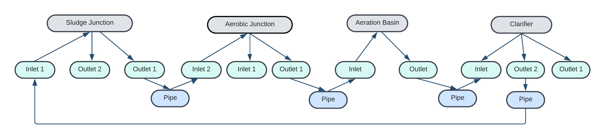
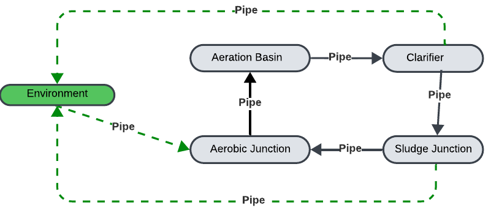

# Flow Graphs for Sensor Placement

Choosing where to put flow sensors so that every flow in a plant can be measured
or computed, using as few sensors as possible, is a graph problem. The plant
becomes a flow graph: nodes are equipment and junctions, and edges are the flows
between them. A sensor-placement algorithm then works on that graph. The
abstraction here follows the WWTP1 case in
["Optimal flow sensor placement on wastewater treatment plants" by Villez et al. (2016)](https://doi.org/10.1016/j.watres.2016.05.068).

Two SPARQL queries extract the graph from a WaTr model. Each returns rows of
`?from ?conn ?to`, one row per edge. The optimization itself is outside WaTr.

## From topology to edges

### Modeling

In a WaTr model a flow passes through five nodes:

```
Equipment -> outlet connection point -> Connection -> inlet connection point -> Equipment
```

S223 inference adds `s223:connectsFrom` and `s223:connectsTo` from each connection
to the equipment at its ends, so one query collapses the path to a single edge
named by the connection:

```sparql
PREFIX s223: <http://data.ashrae.org/standard223#>

SELECT ?from ?conn ?to WHERE {
    ?conn s223:connectsFrom ?from .
    ?conn s223:connectsTo ?to .
}
```

Run S223 inference first. A model loaded from its Turtle source contains only the
`s223:cnx` or `s223:connectsThrough` statements the modeler wrote.

### Rationale

The algorithm reasons about flows between units, not about ports. Connection
points carry direction and medium, which the inference has already used to orient
the edge, so they add nothing to the graph.

## Closing the boundary

### Modeling

Flows that enter or leave the modeled plant have only one end in the model. A
special node, `:Environment`, stands for everything outside, and a second query
attaches every unconnected port to it:

```sparql
PREFIX : <urn:example/flow-graph#>
PREFIX rdf: <http://www.w3.org/1999/02/22-rdf-syntax-ns#>
PREFIX s223: <http://data.ashrae.org/standard223#>

SELECT ?from ?conn ?to WHERE {
    {
        ?port rdf:type s223:OutletConnectionPoint .
        ?from s223:hasConnectionPoint ?port .
        FILTER NOT EXISTS { ?port s223:connectsThrough ?anyConnection }
        FILTER NOT EXISTS { ?port s223:mapsTo ?mapped }
        BIND(?port AS ?conn)
        BIND(:Environment AS ?to)
    }
    UNION
    {
        ?port rdf:type s223:InletConnectionPoint .
        ?to s223:hasConnectionPoint ?port .
        FILTER NOT EXISTS { ?port s223:connectsThrough ?anyConnection }
        FILTER NOT EXISTS { ?port s223:mapsTo ?mapped }
        BIND(?port AS ?conn)
        BIND(:Environment AS ?from)
    }
}
```

An unconnected outlet becomes an edge from its equipment to `:Environment`, and
an unconnected inlet an edge from `:Environment` to its equipment. The port itself
names the edge, since there is no connection to name it. A port that maps to its
container's port is skipped: the container's port already represents that
boundary, and counting both would add a flow that does not exist.

On the inferred {download}`A2O train <../../examples/a2o-train.ttl>`, the first
query returns nine edges between zones, clarifier, pumps and valves. The second
returns three boundary edges: the influent into the anaerobic zone, and the
effluent and waste sludge leaving the clarifier.

### Rationale

A material balance holds at every node only if every flow has two ends. The
environment node closes the graph, so inflows and outflows take part in the
balance like any other edge.

## Before and after

The raw model, with connection points and pipes between equipment:



The flow graph, with direct edges between equipment and the environment node
closing the boundary:



## What is validated

Nothing. These are queries over a model, not shapes. Closing the boundary does not
show that every flow is measured; that is the job of the placement algorithm and
its assumptions. A port left unconnected by mistake becomes a boundary flow here,
and S223 validation reports it only at `sh:Info`, so review those findings before
trusting the graph.
