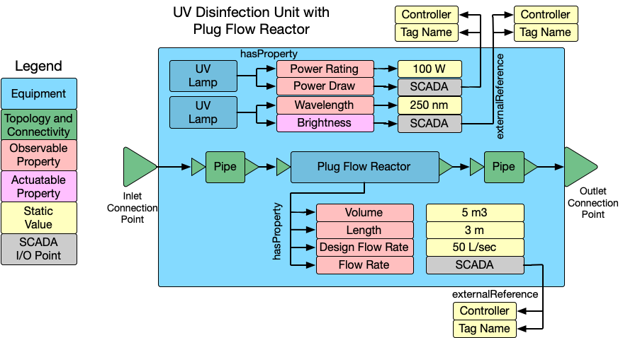

# Modeling Composition, Topology, and Treatment Function

The WaTr ontology supports modeling the **treatment function** of equipment,
the **composition** of the system and its components (for example, "this
reactor contains a lamp"), and the **topology** of the system (for example,
"this pump is connected to this reactor").

To explain these concepts, we will use the following model of an ultraviolet disinfection system:



All of the polygons in this image represent a WaTr entity (a node in the graph) and the edges represent the relationships between them (the edges in the graph).

## Composition

WaTr uses the concept of **composition** to represent how entities are made up of other entities. For example, our UV disinfection system is made up of 2 UV lamps and a plug flow reactor.
We model this using the `s223:contains` relationship between the lamps and the unit process equipment, and the reactor and the unit process equipment.

```ttl
@prefix watr: <https://watermetadata.org/ontology/watr#> .
@prefix owl: <http://www.w3.org/2002/07/owl#> .
@prefix qudt: <http://qudt.org/schema/qudt/> .
@prefix qudtqk: <http://qudt.org/vocab/quantitykind/> .
@prefix rdfs: <http://www.w3.org/2000/01/rdf-schema#> .
@prefix s223: <http://data.ashrae.org/standard223#> .
@prefix unit: <http://qudt.org/vocab/unit/> .
@prefix : <urn:uv_example/> .

:UVDisinfectionSystem a watr:UnitProcess ;
    s223:contains :myPFR, :myUVLamp1, :myUVLamp2 .

:myPFR a watr:PlugFlowReactor .

:myUVLamp1 a s223:Equipment ;
    s223:hasProperty [
        a s223:QuantifiableObservableProperty ;
        qudt:hasQuantityKind qudtqk:Wavelength ;
        s223:hasValue 250 ;
        qudt:hasUnit unit:NanoM ;
    ] .
:myUVLamp2 a s223:Equipment ;
    s223:hasProperty [
        a s223:QuantifiableObservableProperty ;
        qudt:hasQuantityKind qudtqk:Wavelength ;
        s223:hasValue 250 ;
        qudt:hasUnit unit:NanoM ;
    ] .
```

To maintain that these are UV lamps, we included the modeling of the wavelength of the light they emit, which is a characteristic of the lamp. This is done using a `QuantifiableObservableProperty` that has a value of 250 nanometers and a unit of measurement.

## Topology

WaTr gets its topological model from the [ASHRAE 223 Standard](https://docs.open223.info/explanation/223_overview.html). This describes how `Connectables` connect to other `Connectables` through `Connections` and `ConnectionPoints`.

There is some nuance to the model to account for real-world complexities, but the basics are:
- `Connectables` are entities that can connect to other entities (e.g. a pump, a reactor, a valve, a unit process)
- `ConnectionPoints` are the "ports" on a `Connectable` that can connect to other `Connectables` (e.g. the inlet and outlet of a reactor). `ConnectionPoints` have a direction (inlet or outlet) and a medium (e.g. water, air, chemical). (See the docs [here](https://explore.open223.info/s223/ConnectionPoint.html)).
    - use the subclasses `InletConnectionPoint`, `OutletConnectionPoint`, `BidirectionalConnectionPoint` to represent the direction of the connection
    - WaTr defines a set of media that can be associated with the `ConnectionPoint`
- `Connections` are the physical things that connect `Connectables` together (e.g. a pipe, a channel, a duct). They have a `ConnectionPoint` on each end, and they convey a medium (e.g. water, air, chemical). (See the docs [here](https://explore.open223.info/s223/Connection.html).

You can see the connections (the `Pipe`s) and connection points in the image at the top of this page. `Equipment` is a subclass of `Connectable`, so it can have `ConnectionPoints` and `Connections`.

```ttl
@prefix watr: <https://watermetadata.org/ontology/watr#> .
@prefix owl: <http://www.w3.org/2002/07/owl#> .
@prefix qudt: <http://qudt.org/schema/qudt/> .
@prefix qudtqk: <http://qudt.org/vocab/quantitykind/> .
@prefix rdfs: <http://www.w3.org/2000/01/rdf-schema#> .
@prefix s223: <http://data.ashrae.org/standard223#> .
@prefix unit: <http://qudt.org/vocab/unit/> .
@prefix : <urn:uv_example/> .

# defines the "interface" to the unit process
:UVDisinfectionSystem a watr:UnitProcess ;
    s223:cnx :UVInlet, :UVOutlet .
:UVInlet a s223:InletConnectionPoint ;
    s223:hasMedium s223:Fluid-Water .
:UVOutlet a s223:OutletConnectionPoint ;
    s223:hasMedium s223:Fluid-Water .

# PFR participates with the inlet and outlet because
# water flows through it from the inlet to the outlet of
# the unit process
:myPFR a watr:PlugFlowReactor ;
    s223:cnx :PFRInlet, :PFROutlet .
:PFRInlet a s223:InletConnectionPoint ;
    s223:hasMedium s223:Fluid-Water ;
    s223:mapsTo :UVInlet .
:PFROutlet a s223:OutletConnectionPoint ;
    s223:hasMedium s223:Fluid-Water ;
    s223:mapsTo :UVOutlet .
```

We use [`s223:mapsTo`](https://explore.open223.info/s223/mapsTo.html) to relate the connection points of internal equipment to the connection points of the containing equipment. This allows us to model the connections between the unit process and the equipment inside it, for example.

## Media and constituents

### Definitions

A `ConnectionPoint` or `Connection` carries a *medium*, the substance flowing
through it (water, a chemical, air). S223 decides whether two media are
*compatible* by comparing the constituents they are `s223:composedOf`. Two pure
media are compatible only if one is a subclass of the other. Two mixture media are
compatible when they share at least one constituent, either the same one or one
that is a subclass of the other.

WaTr defines several aqueous media as subclasses of `s223:Fluid-Water`:
`Water-Seawater`, `Water-Brackish`, `Water-Freshwater` and `Water-Brine`. Each
declares `s223:composedOf` its constituents, sharing `s223:Constituent-H2O` with
`s223:Fluid-Water` itself:

```ttl
@prefix rdfs: <http://www.w3.org/2000/01/rdf-schema#> .
@prefix s223: <http://data.ashrae.org/standard223#> .
@prefix watr: <https://watermetadata.org/ontology/watr#> .
@prefix qudt: <http://qudt.org/schema/qudt/> .
@prefix quantitykind: <http://qudt.org/vocab/quantitykind/> .
@prefix unit: <http://qudt.org/vocab/unit/> .

watr:Water-Seawater
    rdfs:subClassOf s223:Fluid-Water ;
    s223:composedOf [
        a s223:QuantifiableProperty ;
        s223:ofConstituent s223:Constituent-H2O ;
        qudt:hasQuantityKind quantitykind:MassFraction ;
        qudt:hasUnit unit:PERCENT ;
    ] ;
    s223:composedOf [
        a s223:QuantifiableProperty ;
        s223:ofConstituent watr:Salt-NaCl ;
        qudt:hasQuantityKind quantitykind:MassFraction ;
        qudt:hasUnit unit:PERCENT ;
    ] .
```

`Water-Freshwater` declares only `Constituent-H2O`; the saline media also declare
`watr:Salt-NaCl`.

`watr:Fluid-Sludge` is a semi-solid slurry, a subclass of `s223:Mix-Fluid` composed
of `s223:Constituent-H2O`, `watr:Constituent-OrganicSolids` and
`watr:Constituent-InorganicSolids`. It is not a `Fluid-Water`.

WaTr follows S223's self-enumerated medium pattern: a reusable medium designation
is both a class and an instance of itself, and is used directly as the value of
`s223:hasMedium`. For a reusable salinity such as 15-percent brine, mint a more
specific medium class, type it as itself, subclass it from `Water-Brine` and assert
its composition directly. See {download}`brine-composition.ttl <../../examples/brine-composition.ttl>`.

Composition is not inherited through `rdfs:subClassOf`. A specialized medium does
not acquire the `s223:composedOf` statements of `Water-Brine`; it repeats every
constituent it needs. The superclass organizes the vocabulary and takes part in
class compatibility, but it is not a template.

### Rationale

Because seawater, brackish water, brine and freshwater all declare
`s223:Constituent-H2O`, S223 treats them as mutually compatible. One piece of
equipment can accept a seawater feed and emit freshwater and brine streams without
the validator flagging the media. This claims only a shared constituent, not
equivalent composition or a material balance. See
{download}`ro-mixture-test.ttl <../../examples/ro-mixture-test.ttl>`.

Sludge shares `Constituent-H2O`, so the same rules accept water in and sludge out
of a clarifier, sludge in and supernatant out of a thickener, and a sludge pipe
joined to either kind of connection point. See
[`clarifier-sludge-compatibility.ttl`](../../examples/clarifier-sludge-compatibility.ttl),
which validates both directions. Sludge is not a `Fluid-Water`, so `watr:Pump` is
not a subclass of `s223:Pump`, whose shape warns on any medium other than water,
oil or refrigerant. `watr:Pump` restates those checks for any `s223:Mix-Fluid`.

### Validation

**S223 compatibility.** Connection points and connections must carry compatible
media, by the constituent rule above.

**`watr:CompositionPercentageShape`.** For any node with `s223:composedOf`
fractions in `unit:PERCENT`, the percentages on each common mass or volume basis
may not exceed 100%. For a constituent given as a range with
`s223:Aspect-LowLimit` and `s223:Aspect-HighLimit`, only the greatest declared
lower bound counts, since upper bounds need not hold at once. `Brine-5to10Percent`
(5-10% salt, 90-95% water) conforms because its lower bounds sum to 95%. A
partial composition that names only some constituents stays valid. See
{download}`composition-exceeds-100-percent.ttl <../../examples/nonconforming/composition-exceeds-100-percent.ttl>`.

**`watr:CompleteCompositionShape`.** When `watr:hasCompleteComposition true` is
asserted, the common-basis fractions must be able to total 100%. Exact fractions
totaling 90% fail, as do ranges whose tightest upper bounds total 90%. A missing
value or a lower-only bound can still reach 100% and does not by itself establish
a deficit. Mixed units or bases establish no common total. See
{download}`complete-composition-ranges.ttl <../../examples/complete-composition-ranges.ttl>`
and the rejected
{download}`complete-composition-below-100-percent.ttl <../../examples/nonconforming/complete-composition-below-100-percent.ttl>`.

**`watr:CompositionComplementRule`** (SHACL-AF). Fills in a percentage you did
not state. It applies when the medium declares `watr:hasCompleteComposition true`,
the fractions share a basis and percent units, and exactly one carries no
`s223:hasValue`. That fraction becomes the remainder of the others: 12% salt
with an empty water fraction yields 88%, and 20% salt with 10% solids leaves 70%
for water. The completed fraction can be an inline blank node or a named one;
name it when something else must refer to the inferred value. See
{download}`brine-inferred-complement.ttl <../../examples/brine-inferred-complement.ttl>`.
The rule stays silent when more than one fraction is unquantified, when none is
quantified (so a medium naming only `Constituent-H2O` is not claimed to be 100%
water), when a quantified fraction is a low-limit or high-limit range, or when the
remainder would be negative. The negative case is the over-100% error that
`CompositionPercentageShape` reports.

## Processes

The complete equipment pattern is in [Equipment Type, Treatment Objective,
Process, and Role](equipment_function.md). This section covers the process side
in the context of the UV system.

What a unit does is separate from how it is built. The UV system performs
ultraviolet irradiation for the objective of disinfection, but it is made of a
plug flow reactor and two UV lamps. Another UV system might use a different
reactor or number of lamps and still perform ultraviolet irradiation. Consumers
can query for all units with disinfection as their objective regardless of
construction.

```ttl
@prefix watr: <https://watermetadata.org/ontology/watr#> .
@prefix : <urn:uv_example/> .
:UVDisinfectionSystem a watr:UnitProcess ;
    watr:hasProcess watr:Process-UVIrradiation ;
    watr:hasTreatmentObjective watr:TreatmentObjective-Disinfection ;
.
```

## Process requirements

### Requirements

Each equipment class states the processes it requires with `hasProcess`. An
abstract parent says what kind of process the equipment performs and a concrete
subclass says which one:

```ttl
@prefix sh: <http://www.w3.org/ns/shacl#> .
@prefix watr: <https://watermetadata.org/ontology/watr#> .

watr:Filter
    sh:property [
        sh:path watr:hasProcess ;
        sh:qualifiedValueShape [ sh:class watr:Process-Filtration ] ;   # any filtration process
        sh:qualifiedMinCount 1 ;
    ] .

watr:ReverseOsmosisMembrane
    sh:property [
        sh:path watr:hasProcess ;
        sh:qualifiedValueShape [ sh:class watr:Process-ReverseOsmosis ] ;   # specifically RO
        sh:qualifiedMinCount 1 ;
    ] .
```

The same pattern covers digesters, disinfection and separation: a `Digester`
requires a `Process-Digestion` and an `AnaerobicDigester` a
`Process-AnaerobicDigestion`. `watr:UnitProcess` is the one class that uses a bare
`sh:class`, requiring every `hasProcess` value to be a `watr:Process`.

### Rationale

Process types form a subclass hierarchy with multiple inheritance:
`Process-ReverseOsmosis` is a subtype of both `Process-MembraneProcess` and
`Process-Filtration`. Equipment classes mirror it, so a `ReverseOsmosisMembrane`
is a kind of `Filter`, and one `hasProcess watr:Process-ReverseOsmosis` satisfies
both the inherited general requirement and the concrete one.

Each slot means "performs at least this process". Equipment may declare more. A
moving bed bioreactor aerates, a granular media filter backwashes and an anaerobic
digester mixes:

```ttl
:myMBBR a watr:MovingBedBioreactor ;
    watr:hasProcess watr:Process-Biofiltration ,   # satisfies MBBR and, transitively, Filter
                    watr:Process-Aeration .        # additional
```

WaTr keeps no equipment/process permission lists and issues no plausibility
warnings for additional processes. Possible future checks are in
[Pending Ontology Features](pending_features.md).

### Validation

The constraints are `sh:qualifiedValueShape` with `sh:qualifiedMinCount 1`. A bare
`sh:class` applies to every value on the path and would forbid additional
processes, and `sh:maxCount` has the same effect. Use `sh:qualifiedMaxCount 1`
when a process must appear exactly once. Avoid `sh:qualifiedValueShapesDisjoint`,
which stops one value from satisfying both a parent's slot and a child's.

With inference enabled, `ClassDefaultsRule` adds biofiltration to an MBBR that
states only aeration, or reverse osmosis to an RO unit that states only
microfiltration. With `infer=False`, a missing class-required process fails
validation. Requirements from ancestors combine conjunctively, as everywhere in
SHACL. Process assertions come in three strengths:

| strength | meaning | stated on | expressed by |
|---|---|---|---|
| **required** | an equipment class requires the process | equipment class | `sh:qualifiedValueShape` + `sh:qualifiedMinCount 1` |
| **constituent** | a compound process includes the step | process class | `watr:includesProcess` |
| **explicit** | the modeler states an additional activity | equipment or system instance | `watr:hasProcess` |

Equipment can carry several processes in two ways. *Refinement* states one
activity at two levels, as with RO above. *Co-occurrence* is several activities in
one vessel, as a `SequencingBatchReactor` aerates and settles in successive phases.

## Compound processes and process families

### Definitions

`watr:includesProcess` records what a compound process decomposes into, stated
once on the process type:

```ttl
watr:Process-ActivatedSludge
    watr:includesProcess watr:Process-Aeration ,
                         watr:Process-SolidLiquidSeparation .

watr:Process-AO
    watr:includesProcess watr:Process-Nitrification ,
                         watr:Process-Denitrification .
```

`Process-SolidLiquidSeparation` is a process family. Sedimentation satisfies it in
a conventional activated-sludge train, microfiltration or ultrafiltration in a
membrane bioreactor, flotation in a DAF, centrifugation in a centrifuge.
Recirculation is declared on the configurations that need it: MLE, A2O, UCT and
the Bardenpho processes.

Solid-liquid separation cuts across filtration. `Process-Filtration` and
`Process-MembraneProcess` are separate subtypes of `Process-Separation`.
Microfiltration, ultrafiltration and reverse osmosis are subtypes of both, and
media filtration, microfiltration and ultrafiltration also declare
`Process-SolidLiquidSeparation`:

```ttl
watr:Process-Microfiltration
    rdfs:subClassOf watr:Process-MembraneProcess ,
                    watr:Process-Filtration ,
                    watr:Process-SolidLiquidSeparation .

watr:Process-ReverseOsmosis
    rdfs:subClassOf watr:Process-MembraneProcess ,
                    watr:Process-Filtration .
```

Membrane distillation and electrodialysis are membrane processes without a
filtration parent. Membrane distillation moves water as vapour and electrodialysis
moves ions under an electric potential. Electrodialysis keeps its existing
chemical-process parent.

### Rationale

The step names the family, not `Process-Separation` above it, because screening
and stripping are separations too and neither is the step in which a train parts
its biomass from the treated water. Reverse osmosis does not satisfy the
suspended-solids separation step of an activated-sludge train. Treatment-train
processes such as MLE, A2O, UCT and Bardenpho are asserted on the system whose
members perform the steps. An integrated unit such as a sequencing batch reactor
may carry a compound process itself.

### Validation

`SystemProcessCoverageShape` (a warning) reports a system when neither it, a
transitively nested member, nor equipment contained in a member performs a
required step:

```ttl
:MLESystem a s223:System ;
    s223:hasMember :anoxicZone, :aerationBasin, :secondaryClarifier, :rasPump ;
    watr:hasProcess watr:Process-MLE .

:anoxicZone a watr:MixingBasin ;
    watr:hasProcess watr:Process-Mixing , watr:Process-Denitrification ;
    s223:hasRole watr:Role-Anoxic .
```

A compound process uses `includesProcess` for its steps and is not an
`rdfs:subClassOf` them. The warning severity allows partial system models. See
[Processes Performed by Systems](system_processes.md) for the full pattern and the
coverage query.

## Roles

### Definitions

A role is the commissioned function of an entity within a system. WaTr defines
roles in these groups:

| group | roles |
|---|---|
| treatment stage | `Role-Primary`, `Role-Secondary`, `Role-Tertiary`, `Role-Pretreatment`, `Role-Posttreatment` |
| zone regime | `Role-Aerobic`, `Role-Anoxic`, `Role-Anaerobic` |
| operational purpose | `Role-Storage`, `Role-Equalization`, `Role-Detention`, `Role-Retention`, `Role-Containment`, `Role-Extended`, `Role-Stepfeed` |
| connection point | `Role-Drain`, `Role-Overflow`, `Role-Feed`, `Role-Permeate`, `Role-MakeUp` |

`watr:Role-Primary` and `watr:Role-Secondary` refer to wastewater treatment
stages. The similarly named S223 roles refer to primary and secondary loops.

### Rationale

S223 roles describe commissioned function, not instantaneous state: a heating coil
keeps `Role-Heating` while switched off. `Role-Aerobic`, `Role-Anoxic` and
`Role-Anaerobic` say which regime a zone is commissioned to run in, which is what
lets the role slots on `AerationBasin` and `MixingBasin` tell the zones of a train
apart. Read as bare capability they would be vacuous, since any basin with
diffusers can run aerobic. A swing zone commissioned for either regime carries both
roles whatever its blowers are doing.

Dissolved oxygen at a point in time is a reading, not a role. It belongs on an
`s223:QuantifiableObservableProperty` of the medium, which a `watr:OxygenMeter`
observes:

```ttl
:swing_zone a watr:AerationBasin ;
    s223:hasRole watr:Role-Aerobic, watr:Role-Anoxic ;      # commissioned for either
    watr:hasProcess watr:Process-Aeration, watr:Process-Denitrification ;
    watr:hasTreatmentObjective watr:TreatmentObjective-NitrogenRemoval .

:do_meter a watr:OxygenMeter ;
    s223:hasObservationLocation :swing_zone ;
    s223:observes :dissolved_oxygen .

:dissolved_oxygen a s223:QuantifiableObservableProperty ;    # what it is doing now
    s223:ofMedium s223:Fluid-Water ;
    s223:ofSubstance watr:Constituent-DissolvedOxygen ;
    qudt:hasQuantityKind quantitykind:MassConcentration ;
    qudt:hasUnit unit:MilliGM-PER-L .
```

### Validation

Roles are never inferred or checked against readings. A reading near zero does not
withdraw `Role-Aerobic`, and 2 mg/L does not withdraw `Role-Anoxic`.
`examples/swing-zone-dissolved-oxygen.ttl` is the whole model, validated with the
other examples.

## Treatment objectives and processes

### Definitions

What equipment is for and what it does are separate vocabularies:
`watr:TreatmentObjective-*` names objectives and `watr:Process-*` names
activities. No term is both. A process type with a fixed objective states it once
with `watr:achievesTreatmentObjective`:

```ttl
watr:Process-Denitrification  watr:achievesTreatmentObjective watr:TreatmentObjective-NitrogenRemoval .
watr:Process-Chlorination     watr:achievesTreatmentObjective watr:TreatmentObjective-Disinfection .
watr:Process-MLE              watr:achievesTreatmentObjective watr:TreatmentObjective-NitrogenRemoval .
```

Filtration and settling inherit broad constituent removal from separation, and the
modeler states the specific target or product objective. Generic ozonation, UV
irradiation and thermal treatment leave theirs to design or plant intent.
`Process-Nitrification` achieves `TreatmentObjective-AmmoniaControl`, not
`TreatmentObjective-NitrogenRemoval`, which is why `AmmoniaControl` sits outside
`NutrientRemoval`. `Process-ChemicalPrecipitation` declares broad constituent
removal, and its specific target depends on the reagent. The objectives it may
serve are named so equipment has something to point at: `Softening`,
`PhosphorusRemoval`, `MetalsRemoval`, `SulfateRemoval` and `SilicaRemoval`.

### Rationale

Neither relation between the two is a hierarchy. One process serves several
objectives, and one objective is reached by several processes. See
[Equipment Type, Treatment Objective, Process, and Role](equipment_function.md)
for the examples. A practitioner reads a clarifier as clarifying by settling, and
naming the mechanism alone leaves the objective unstated.

Class-defined processes and design objectives follow equipment when its stage
changes. Target-specific objectives depend on plant intent and stay explicit. A
primary and a secondary clarifier share settling and clarification and differ only
in their stage role.

### Validation

`watr:ProcessValueShape` and `watr:TreatmentObjectiveValueShape` keep the
vocabularies apart: an objective asserted with `watr:hasProcess` is rejected, and
an activity asserted with `watr:hasTreatmentObjective` likewise.
`watr:TreatmentObjectiveRequiresProcessShape` requires a process after inference;
a class default can supply it, and with inference disabled it must be stated.
`watr:ProcessBearerShape` restricts both predicates to `s223:Equipment` and
`s223:System`. These are shapes, not `rdfs:domain` and `rdfs:range` axioms, on
purpose: axioms would infer types onto an invalid model instead of rejecting it.

## Putting It All Together

The fragments above illustrate individual aspects of a model. The complete
example below combines composition, topology, and treatment function. UV lamps
use generic `s223:Equipment` with wavelength properties; WaTr defines no separate
lamp class. The reactor explicitly performs UV irradiation, since containment
does not copy a parent's process onto its components.

```ttl
@prefix watr: <https://watermetadata.org/ontology/watr#> .
@prefix owl: <http://www.w3.org/2002/07/owl#> .
@prefix qudt: <http://qudt.org/schema/qudt/> .
@prefix qudtqk: <http://qudt.org/vocab/quantitykind/> .
@prefix rdfs: <http://www.w3.org/2000/01/rdf-schema#> .
@prefix s223: <http://data.ashrae.org/standard223#> .
@prefix unit: <http://qudt.org/vocab/unit/> .
@prefix : <urn:uv_example/> .
:UVDisinfectionSystem a watr:UnitProcess ;
    rdfs:label "UVDisinfectionSystem" ;
    watr:hasProcess watr:Process-UVIrradiation ;
    watr:hasTreatmentObjective watr:TreatmentObjective-Disinfection ;
    s223:contains :myPFR, :myUVLamp1, :myUVLamp2 ;
    s223:cnx :UVInlet, :UVOutlet .

:UVInlet a s223:InletConnectionPoint ;
    rdfs:label "UVInlet" ;
    s223:hasMedium s223:Fluid-Water .
:UVOutlet a s223:OutletConnectionPoint ;
    rdfs:label "UVOutlet" ;
    s223:hasMedium s223:Fluid-Water .

:myPFR a watr:PlugFlowReactor ;
    rdfs:label "myPFR" ;
    watr:hasProcess watr:Process-UVIrradiation ;
    s223:cnx :PFRInlet, :PFROutlet .
:PFRInlet a s223:InletConnectionPoint ;
    rdfs:label "PFRInlet" ;
    s223:hasMedium s223:Fluid-Water ;
    s223:mapsTo :UVInlet .
:PFROutlet a s223:OutletConnectionPoint ;
    rdfs:label "PFROutlet" ;
    s223:hasMedium s223:Fluid-Water ;
    s223:mapsTo :UVOutlet .

:myUVLamp1 a s223:Equipment ;
    rdfs:label "myUVLamp1" ;
    s223:hasProperty [
        a s223:QuantifiableObservableProperty ;
        rdfs:label "Emitted wavelength" ;
        qudt:hasQuantityKind qudtqk:Wavelength ;
        s223:hasValue 250 ;
        qudt:hasUnit unit:NanoM ;
    ] .
:myUVLamp2 a s223:Equipment ;
    rdfs:label "myUVLamp2" ;
    s223:hasProperty [
        a s223:QuantifiableObservableProperty ;
        rdfs:label "Emitted wavelength" ;
        qudt:hasQuantityKind qudtqk:Wavelength ;
        s223:hasValue 250 ;
        qudt:hasUnit unit:NanoM ;
    ] .
```

### Treatment objectives inferred from mechanisms

SHACL-AF rules supply class-required processes and design objectives, then
supply the objectives declared by those processes or their ancestors. All
separation processes imply broad constituent removal. A modeler still states
the specific target or product intent, such as desalination, arsenic removal,
lead removal, or resource recovery. Backwashing and other cleaning activities
imply equipment cleaning. These annotations describe intended function and do
not validate observed removal efficiency or permit compliance.

A flowing **medium** is distinct from a filter **medium**: water or brine flows
through equipment, while sand, carbon, resin, or a membrane provides the
separation material. Shared-constituent compatibility is a topology check. It
does not establish membrane selectivity, pumping suitability, or mass balance.
See the [treatment references and review decisions](treatment_review.md).
